# 🚀 Estrategia de Branching Git para MELI

> Gestión de desarrollo paralelo con integración continua y despliegues controlados

## 📋 Tabla de Contenidos

- [Diagrama de Flujo](#-diagrama-de-flujo-completo)
- [Estructura de Ramas](#-estructura-de-ramas)
- [Flujo de Trabajo](#-flujo-de-trabajo-detallado)
  - [Fase 1: Desarrollo](#fase-1-desarrollo-de-iniciativa-)
  - [Fase 2: MELI DEV](#fase-2-despliegue-a-meli-dev-)
  - [Fase 3: MELI UAT](#fase-3-transporte-a-meli-uat-)
  - [Fase 4: Preparación PRD](#fase-4-preparación-para-meli-prd-)
  - [Fase 5: MELI PRD](#fase-5-despliegue-a-meli-prd-)
- [Reglas y Prácticas](#️-reglas-y-mejores-prácticas)
- [Nomenclatura](#-convenciones-de-nomenclatura)
- [Ambientes](#-ambientes)

---

## 📊 Diagrama de Flujo Completo

```mermaid
flowchart TD
    Start([Inicio:<br/>Código en Producción]) --> Master[Rama MASTER<br/>Código actual en PRD]

    Master --> CreateBase[Crear feature/base<br/>desde master]
    Master --> CreateDev1[Crear feature/inic1111<br/>desde master]
    Master --> CreateDevN[Crear feature/inicXXXX<br/>desde master]

    CreateBase --> Base[feature/base]
    CreateDev1 --> Dev1[feature/inic1111<br/>Desarrollo en paralelo]
    CreateDevN --> DevN[feature/inicXXXX<br/>Desarrollo en paralelo<br/>Mismo Flujo feature/inic1111]

    %% Flujo para MELI DEV
    Dev1 --> DecisionDev1{¿Listo para<br/>MELI DEV?}
    DecisionDev1 -->|Sí| ConflictBase{¿Conflictos al<br/>mergear a feature/base?}
    ConflictBase -->|No| MergeDirectBase[PR feature/inic1111<br/>→ feature/base]
    ConflictBase -->|Sí| CreateTrans1[Desde feature/base crear<br/>feature/inic1111ToBase]
    CreateTrans1 --> Trans1[Merge firmado de feature/inic1111<br/>dentro de inic1111ToBase<br/>Resolver conflictos]
    Trans1 --> MergeToBase1[PR feature/inic1111ToBase<br/>→ feature/base]
    MergeToBase1 --> DeleteTrans1[Borrar<br/>feature/inic1111ToBase]

    Base --> BaseLista
    MergeDirectBase --> BaseLista
    MergeToBase1 --> BaseLista{feature/base<br/>actualizada}

    BaseLista --> ConflictDevelop{¿Conflictos<br/>feature/base → develop?}
    ConflictDevelop -->|No| CreatePRDev[Crear PR<br/>feature/base → develop]
    ConflictDevelop -->|Sí| CreateBaseTrans[Desde develop crear<br/>feature/baseToDevelop]
    CreateBaseTrans --> BaseTrans[Merge firmado de feature/base<br/>dentro de baseToDevelop<br/>Resolver conflictos]
    BaseTrans --> PRBaseTrans[Crear PR<br/>feature/baseToDevelop → develop]
    CreatePRDev --> ApproveDev[Aprobar + Merge PR]
    PRBaseTrans --> ApproveDev
    ApproveDev --> DeployDev[Despliegue automático<br/>MELI DEV]
    DeployDev --> RequestIDDev[CI/CD genera<br/>Request ID]

    %% Flujo para MELI UAT
    RequestIDDev --> DecisionUAT{¿Llevar a<br/>MELI UAT?}
    DecisionUAT -->|Sí| TransportUAT[Transportar Request ID<br/>por medio de SOLMAN]
    TransportUAT --> DeployUAT[Despliegue<br/>MELI UAT]

    %% Flujo para MELI PRD
    Dev1 --> DecisionPRD1{¿Listo para<br/>MELI PRD?}
    DevN --> DecisionPRDN{¿Listo para<br/>MELI PRD?}

    DecisionPRD1 -->|Sí| CreateRelease[Crear feature/release-DDMM<br/>desde master]
    DecisionPRDN -->|Sí| CreateRelease

    CreateRelease --> Release[feature/release-DDMM]
    Release --> MergeInit1[Merge firmado feature/inic1111<br/>→ feature/release-DDMM]
    Release --> MergeInitN[Merge firmado feature/inicXXXX<br/>→ feature/release-DDMM]

    MergeInit1 --> ReleaseReady
    MergeInitN --> ReleaseReady{feature/release-DDMM<br/>consolidada}

    ReleaseReady --> ConflictCheck{¿Conflictos<br/>feature/release → develop?}
    ConflictCheck -->|No| PRProd[Crear PR<br/>feature/release-DDMM → develop]
    ConflictCheck -->|Sí| CreateReleaseTrans[Desde develop crear<br/>release-DDMMToDevelop]
    CreateReleaseTrans --> ReleaseTrans[Merge firmado de feature/release-DDMM<br/>dentro de release-DDMMToDevelop<br/>Resolver conflictos]
    ReleaseTrans --> PRReleaseTrans[Crear PR<br/>release-DDMMToDevelop → develop]
    PRProd --> ApproveProd[Aprobar + Merge PR]
    PRReleaseTrans --> ApproveProd

    ApproveProd --> DeployDevProd[Despliegue<br/>MELI DEV]
    DeployDevProd --> RequestIDProd[CI/CD genera<br/>Request ID]

    RequestIDProd --> TransportProd[Transportar Request ID<br/>por SOLMAN a UAT]
    TransportProd --> UATCheck[Pasa por MELI UAT<br/>Validación aislada]
    UATCheck --> TransportPRD[Transporte a<br/>MELI PRD]

    %% Actualización post-producción
    TransportPRD --> ConfirmPRD{¿Despliegue<br/>confirmado<br/>en PRD?}
    ConfirmPRD -->|Sí| PRMasterStable[Crear PR<br/>master → master-stable<br/>Imagen PRD antes de cambios]
    PRMasterStable --> ApproveMasterStable[Aprobar + Merge PR<br/>master → master-stable]
    ApproveMasterStable --> UpdateMaster[Crear PR<br/>feature/release-DDMM → master]
    UpdateMaster --> ApproveMergeMaster[Aprobar + Merge PR<br/>feature/release-DDMM → master]
    ApproveMergeMaster --> End([Proceso Completado<br/>PRD Actualizado])

    %% Estilos
    classDef mainBranchStyle fill:#ff6b6b,stroke:#c92a2a,stroke-width:3px,color:#fff
    classDef featureBranchStyle fill:#a78bfa,stroke:#7c3aed,stroke-width:2px,color:#fff
    classDef releaseBranchStyle fill:#4dabf7,stroke:#1971c2,stroke-width:2px,color:#fff
    classDef devPathStyle fill:#ff922b,stroke:#e8590c,stroke-width:2px,color:#fff
    classDef prdPathStyle fill:#51cf66,stroke:#2f9e44,stroke-width:2px,color:#fff
    classDef decisionStyle fill:#f8f9fa,stroke:#495057,stroke-width:2px,color:#000

    class Master mainBranchStyle
    class Base,Dev1,DevN,Trans1,CreateTrans1,MergeDirectBase,CreateBaseTrans,BaseTrans,PRBaseTrans featureBranchStyle
    class Release,CreateRelease,MergeInit1,MergeInitN,ReleaseReady releaseBranchStyle
    class CreatePRDev,ApproveDev,DeployDev,RequestIDDev,TransportUAT,DeployUAT devPathStyle
    class PRProd,ApproveProd,DeployDevProd,RequestIDProd,TransportProd,UATCheck,TransportPRD,ConfirmPRD,PRMasterStable,ApproveMasterStable,UpdateMaster,ApproveMergeMaster prdPathStyle
    class CreateReleaseTrans,ReleaseTrans,PRReleaseTrans featureBranchStyle
    class DecisionDev1,DecisionPRD1,DecisionPRDN,DecisionUAT,BaseLista,ConflictBase,ConflictDevelop,ConflictCheck decisionStyle
```



### 🎨 Leyenda de Colores

| Color | Descripción |
|-------|-------------|
| 🔴 **Rojo** | Ramas principales (master) |
| 🟣 **Morado** | Ramas feature (feature/inic*, feature/*ToBase) |
| 🔵 **Azul claro** | Ramas release/base (feature/release-DDMM, feature/base) |
| 🟠 **Naranja** | Flujo DEV - Despliegue a MELI DEV/UAT |
| 🟢 **Verde** | Flujo PRD - Despliegue a MELI PRD |
| ⚪ **Gris** | Decisiones y puntos de control |

---

## 🌳 Estructura de Ramas

| Rama | Propósito | Ciclo de Vida |
|------|-----------|---------------|
| `master` 🔒 | Refleja el código en producción (MELI PRD) | Permanente |
| `master-stable` 🔒 | Imagen del estado de PRD antes de cada despliegue (snapshot previo) | Permanente |
| `develop` 🔒 | Rama de integración para despliegues automáticos | Permanente |
| `feature/inicXXXX` | Desarrollo de iniciativas individuales en paralelo | Temporal |
| `feature/base` | Rama de consolidación para múltiples iniciativas que van a DEV | Semi-permanente |
| `feature/inicXXXXToBase` | Rama de transición para resolver conflictos antes del merge | Temporal |
| `feature/baseToDevelop` | Rama de transición para integrar `feature/base` en `develop` | Temporal |
| `feature/release-DDMM` | Consolida iniciativas listas para PRD (siempre requerida) | Temporal |
| `release-DDMMToDevelop` | Rama de transición para integrar una release en `develop` | Temporal |

> 🔒 **Ramas Protegidas:** `master` y `develop` son ramas protegidas. Solo se pueden actualizar mediante Pull Request aprobado.

---

## 🔄 Flujo de Trabajo Detallado

### Fase 1: Desarrollo de Iniciativa 🔧

**1. Crear rama de iniciativa desde master**

```bash
git switch master
git pull --ff-only origin master
git switch -c feature/inic1111
```

**2. Desarrollar la funcionalidad**

Commits frecuentes y firmados en `feature/inic1111`:

```bash
git add .
git commit -S -m "feat: iniciativa 1111"
git push -u origin HEAD
```

**3. Crear rama de transición desde `feature/base`**

```bash
git switch feature/base
git pull --ff-only origin feature/base
git switch -c feature/inic1111ToBase
```

**4. Integrar la iniciativa dentro de la rama temporal**

```bash
git merge --no-ff -S origin/feature/inic1111

# Si hay conflictos, resolverlos y finalizar el merge firmado
git add .
git commit -S -m "Integrate inic1111 into feature/base"
git push -u origin HEAD
```

Crear, aprobar y mergear el PR:

```text
feature/inic1111ToBase → feature/base
```

> 💡 La temporal nace desde `feature/base`. De esta manera, `feature/inic1111` no absorbe las demás iniciativas ya consolidadas.

**5. Borrar rama de transición**

```bash
git switch feature/base
git branch -d feature/inic1111ToBase
git push origin --delete feature/inic1111ToBase
```

> 💡 **Nota:** No se debe crear después otro PR de `feature/inic1111 → feature/base`; el merge realizado en la temporal ya incorporó la iniciativa.

---

### Fase 2: Despliegue a MELI DEV 🚀

**1. Integrar `feature/base` en `develop`**

Si no hay conflictos, crear el PR directo:

```text
feature/base → develop
```

Si hay conflictos, no incorporar `develop` dentro de `feature/base`. Posicionarse en `develop` y crear desde allí la rama de transición:

```bash
git switch develop
git pull --ff-only origin develop
git switch -c feature/baseToDevelop
git merge --no-ff -S origin/feature/base

# Si hay conflictos, resolverlos y finalizar el merge firmado
git add .
git commit -S -m "Integrate feature/base into develop for UAT"
git push -u origin HEAD
```

Crear el PR:

```text
feature/baseToDevelop → develop
```

**2. Aprobar el PR y ejecutar el Merge**

La aprobación permite hacer el merge. El merge dispara el despliegue automático a MELI DEV.

Cuando hubo conflictos, el PR `feature/baseToDevelop → develop` es el que debe disparar CI/CD. No es necesario volver a crear un PR desde `feature/base`.

**3. CI/CD genera Request ID automáticamente**

Este ID se usa para transportar el código a otros ambientes

**4. Validación en MELI DEV**

Probar la funcionalidad en el ambiente de desarrollo

---

### Fase 3: Transporte a MELI UAT 🧪

> ⚠️ **Importante:** El transporte a UAT se usa para pruebas de aceptación de usuario o cuando no se cuenta con datos en ambiente MELI DEV.

**1. Transportar Request ID a través de SOLMAN**

Usar SOLMAN para mover el Request ID de DEV a UAT

**2. Validación en MELI UAT**

Realizar pruebas de aceptación o validar con datos reales

---

### Fase 4: Preparación para MELI PRD 📦

> 📦 **Importante:** Siempre se debe crear una rama release para pasar a producción, independientemente de si es una o múltiples iniciativas.

**1. Crear rama de release**

```bash
git switch master
git pull --ff-only origin master
git switch -c feature/release-1201
# Formato: DDMM (día y mes)
```

**2. Consolidar iniciativa(s)**

```bash
# Para una iniciativa:
git merge --no-ff -S origin/feature/inic1111

# Para múltiples iniciativas:
git merge --no-ff -S origin/feature/inic1111
git merge --no-ff -S origin/feature/inic2222

git push -u origin HEAD
```

**3. Crear PR desde la release**

```bash
# Crear PR: feature/release-1201 → develop
```

**4. Resolver conflictos (si aplica)**

> ⚠️ **Importante:** Si el PR presenta conflictos, **no actualizar la release incorporándole `develop`**. La release debe mantenerse limpia para actualizar posteriormente `master`.

```bash
# Posicionarse en develop y crear desde allí la rama temporal
git switch develop
git pull --ff-only origin develop
git switch -c release-1201ToDevelop

# Integrar la release dentro de la rama temporal
git merge --no-ff -S origin/feature/release-1201

# Si hay conflictos, resolverlos sin omitir cambios vigentes de develop
git add .
git commit -S -m "Integrate release-1201 into develop"
git push -u origin HEAD
```

Una vez resueltos los conflictos, crear, aprobar y mergear el PR:

```text
release-1201ToDevelop → develop
```

Este PR debe disparar CI/CD y generar el Request ID. Su último merge contiene los cambios de `feature/release-1201` y la resolución necesaria sobre el estado actual de `develop`.

Después de ese merge, eliminar la rama temporal:

```bash
git switch develop
git branch -d release-1201ToDevelop
git push origin --delete release-1201ToDevelop
```

No se debe realizar después un segundo PR de `feature/release-1201 → develop`: la integración de la temporal ya incorporó la release.

> 💡 **Por qué este flujo:** `release-DDMMToDevelop` nace desde `develop` e integra dentro de ella `feature/release-1201`. Los commits históricos sin firma de `develop` ya pertenecen a la base y no forman parte del rango nuevo. La release original permanece aislada para su posterior integración en `master`.

> ⚠️ **CI/CD y cambios menores:** No agregar un espacio, comentario u otro cambio cosmético a `feature/release-1201` para disparar un segundo PR. Como CI/CD utiliza el último commit, podría procesar únicamente ese cambio menor. El PR `release-1201ToDevelop → develop` debe ser el disparador efectivo.

**5. Aprobar el PR y ejecutar el Merge**

El merge dispara el despliegue a MELI DEV y genera el Request ID para transportar a UAT y PRD.

---

### Fase 5: Despliegue a MELI PRD ✅

> ✅ **Flujo de Producción:** El código desplegado en DEV se transporta a UAT → PRD usando SOLMAN.

**1. Verificar despliegue en MELI DEV**

El merge de la Fase 4 generó un Request ID automáticamente.

**2. Transportar a MELI UAT**

Validación aislada vía SOLMAN

**3. Transportar a MELI PRD**

Despliegue final a producción

**4. Confirmar despliegue en PRD**

Validar funcionamiento

**5. Generar snapshot de PRD en master-stable**

> 📸 **Importante:** Antes de actualizar `master`, se debe crear un PR de `master → master-stable`. Esto permite conservar una imagen del estado de PRD *antes* de los cambios transportados, útil para rollback o comparación.

```bash
# Crear PR: master → master-stable
# Aprobar y mergear para capturar el estado actual de PRD
```

**6. Actualizar master**

```bash
# Crear PR: feature/release-DDMM → master
# Aprobar y mergear el PR → master estará actualizado
```

> 🔒 **Nota:** Las ramas protegidas (master, master-stable, develop) solo se actualizan mediante Pull Request. Nunca hacer push directo.

---

## ⚠️ Reglas y Mejores Prácticas

### 🚫 Prohibiciones Importantes

- **NUNCA** incorporar `feature/base` dentro de una iniciativa para resolver conflictos
- **NUNCA** incorporar `develop` dentro de `feature/base` o de una release
- **NUNCA** resolver conflictos del PR release directamente: usar `release-DDMMToDevelop` creada desde `develop`
- **NUNCA** omitir cambios de `develop` al resolver conflictos en la rama temporal (riesgo de pérdida de información)
- **NUNCA** agregar un cambio cosmético para crear un segundo PR después de integrar la rama temporal
- **NUNCA** mezclar iniciativas DEV con PRD en el mismo PR
- **NUNCA** hacer push directo a `master` o `develop` (solo mediante PR)
- **NUNCA** pasar a PRD sin crear una rama release

### ✅ Mejores Prácticas

- ✔️ Crear cada rama de transición desde la rama destino
- ✔️ Integrar la rama fuente dentro de la transición mediante un merge firmado
- ✔️ Borrar ramas de transición después del merge
- ✔️ Mantener `feature/base` y las releases aisladas del historial de `develop`
- ✔️ Usar `git pull --ff-only` al actualizar la rama de partida
- ✔️ Usar `git push -u origin HEAD` para el primer push de una rama nueva
- ✔️ Usar **Create a merge commit** en los PR para conservar la ascendencia
- ✔️ Nombrar releases con formato DDMM
- ✔️ Siempre crear rama release para despliegues a PRD
- ✔️ Validar en UAT cuando sea necesario
- ✔️ Documentar Request IDs para trazabilidad
- ✔️ Actualizar master inmediatamente después de PRD

### 📋 Checklist de Despliegue a PRD

- [ ] Rama release creada (feature/release-DDMM)
- [ ] Iniciativa(s) consolidada(s) en release
- [ ] Commits de iniciativas, release y resolución de conflictos firmados
- [ ] Rama `release-DDMMToDevelop` creada desde `develop` cuando hubo conflictos
- [ ] PR creado, aprobado y mergeado a develop
- [ ] Código desplegado a MELI DEV
- [ ] Request ID generado por CI/CD
- [ ] Request ID transportado a MELI UAT
- [ ] Validación exitosa en MELI UAT
- [ ] Request ID transportado a MELI PRD
- [ ] Validación exitosa en MELI PRD
- [ ] PR master → master-stable aprobado y mergeado (snapshot previo a cambios)
- [ ] Master actualizado (PR release → master)
- [ ] Ramas temporales borradas

---

## 📝 Convenciones de Nomenclatura

| Tipo | Formato | Ejemplo |
|------|---------|---------|
| Iniciativa | `feature/inicXXXX` | `feature/inic1111` |
| Transición | `feature/inicXXXXToBase` | `feature/inic1111ToBase` |
| Base | `feature/base` | `feature/base` |
| Base (temporal hacia develop) | `feature/baseToDevelop` | `feature/baseToDevelop` |
| Release | `feature/release-DDMM` | `feature/release-1201` |
| Release (temporal conflictos) | `release-DDMMToDevelop` | `release-1201ToDevelop` |
| Request ID | Generado por CI/CD | REQ-2024-001234 |

---

## 🎯 Ambientes

```
┌─────────────┐      ┌─────────────┐      ┌─────────────┐
│  MELI DEV   │  →   │  MELI UAT   │  →   │  MELI PRD   │
└─────────────┘      └─────────────┘      └─────────────┘
```

### 📌 Cuándo usar MELI UAT:

- Para pruebas de aceptación de usuario (UAT - User Acceptance Testing)
- Cuando MELI DEV no cuenta con los datos necesarios para validar

### Descripción de Ambientes:

- **MELI DEV:** Despliegue automático al hacer merge a develop. Ambiente para desarrollo y pruebas iniciales.
- **MELI UAT:** Transporte manual vía SOLMAN. Ambiente para pruebas de aceptación y validación con datos reales.
- **MELI PRD:** Transporte manual vía SOLMAN. Ambiente de producción. Solo se despliega después de validación en UAT.

---

<div align="center">

**Estrategia de Branching Git - MercadoLibre**  
_Versión 4 - Octubre 2026_

</div>
