# 🚀 Estrategia de Branching Git para MELI

> Gestión de desarrollo paralelo con integración continua y despliegues controlados

## 📋 Tabla de Contenidos

- [Diagrama de Flujo](#-diagrama-de-flujo-completo)
- [Estructura de Ramas](#-estructura-de-ramas)
- [Flujo de Trabajo](#-flujo-de-trabajo-detallado)
  - [Fase 1: Desarrollo](#fase-1-desarrollo-de-iniciativa-)
  - [Fase 2: MELI DEV](#fase-2-despliegue-a-meli-dev-)
  - [Fase 3: MELI UAT](#fase-3-transporte-a-meli-uat-)
  - [Fase 4: Preparación PRD](#fase-4-preparación-para-meli-prd-)
  - [Fase 5: MELI PRD](#fase-5-despliegue-a-meli-prd-)
- [Refirma de commits históricos](#-refirma-de-commits-históricos-en-ramas-temporales)
- [Reglas y Prácticas](#️-reglas-y-mejores-prácticas)
- [Nomenclatura](#-convenciones-de-nomenclatura)
- [Ambientes](#-ambientes)

---

## 📊 Diagrama de Flujo Completo

```mermaid
flowchart TD
    Start([Inicio:<br/>Código en Producción]) --> Master[Rama MASTER<br/>Código actual en PRD]

    Master --> CreateBase[Crear feature/base<br/>desde master]
    Master --> CreateDev1[Crear feature/inic1111<br/>desde master]
    Master --> CreateDevN[Crear feature/inicXXXX<br/>desde master]

    CreateBase --> Base[feature/base]
    CreateDev1 --> Dev1[feature/inic1111<br/>Desarrollo en paralelo]
    CreateDevN --> DevN[feature/inicXXXX<br/>Desarrollo en paralelo<br/>Mismo Flujo feature/inic1111]

    %% Flujo para MELI DEV
    Dev1 --> DecisionDev1{¿Listo para<br/>MELI DEV?}
    DecisionDev1 -->|Sí| ConflictBase{¿El PR hacia<br/>feature/base tiene conflictos?}
    ConflictBase -->|No| MergeDirectBase[PR feature/inic1111<br/>→ feature/base]
    ConflictBase -->|Sí| CreateTrans1[Desde feature/inic1111 crear<br/>feature/inic1111ToBase]
    CreateTrans1 --> Trans1[Merge firmado de feature/base<br/>dentro de inic1111ToBase<br/>Resolver conflictos]
    Trans1 --> SignTrans1{¿El rango del PR tiene<br/>commits sin firma?}
    SignTrans1 -->|Sí| RebaseTrans1[Rebase + refirma sobre<br/>origin/feature/base]
    SignTrans1 -->|No| MergeToBase1
    RebaseTrans1 --> MergeToBase1[PR feature/inic1111ToBase<br/>→ feature/base]
    MergeToBase1 --> DeleteTrans1[Borrar<br/>feature/inic1111ToBase]

    Base --> BaseLista
    MergeDirectBase --> BaseLista
    MergeToBase1 --> BaseLista{feature/base<br/>actualizada}

    BaseLista --> ConflictDevelop{¿El PR feature/base → develop<br/>tiene conflictos?}
    ConflictDevelop -->|No| CreatePRDev[Crear PR<br/>feature/base → develop]
    ConflictDevelop -->|Sí| CreateBaseTrans[Desde feature/base crear<br/>feature/baseToDevelop]
    CreateBaseTrans --> BaseTrans[Merge firmado de develop<br/>dentro de baseToDevelop<br/>Resolver conflictos]
    BaseTrans --> SignBaseTrans{¿El rango del PR tiene<br/>commits sin firma?}
    SignBaseTrans -->|Sí| RebaseBaseTrans[Rebase + refirma sobre<br/>origin/develop]
    SignBaseTrans -->|No| PRBaseTrans
    RebaseBaseTrans --> PRBaseTrans[Crear PR<br/>feature/baseToDevelop → develop]
    CreatePRDev --> ApproveDev[Aprobar + Merge PR]
    PRBaseTrans --> ApproveDev
    ApproveDev --> DeployDev[Despliegue automático<br/>MELI DEV]
    DeployDev --> RequestIDDev[CI/CD genera<br/>Request ID]

    %% Flujo para MELI UAT
    RequestIDDev --> DecisionUAT{¿Llevar a<br/>MELI UAT?}
    DecisionUAT -->|Sí| TransportUAT[Transportar Request ID<br/>por medio de SOLMAN]
    TransportUAT --> DeployUAT[Despliegue<br/>MELI UAT]

    %% Flujo para MELI PRD
    Dev1 --> DecisionPRD1{¿Listo para<br/>MELI PRD?}
    DevN --> DecisionPRDN{¿Listo para<br/>MELI PRD?}

    DecisionPRD1 -->|Sí| CreateRelease[Crear feature/release-DDMM<br/>desde master]
    DecisionPRDN -->|Sí| CreateRelease

    CreateRelease --> Release[feature/release-DDMM]
    Release --> MergeInit1[Merge firmado feature/inic1111<br/>→ feature/release-DDMM]
    Release --> MergeInitN[Merge firmado feature/inicXXXX<br/>→ feature/release-DDMM]

    MergeInit1 --> ReleaseReady
    MergeInitN --> ReleaseReady{feature/release-DDMM<br/>consolidada}

    ReleaseReady --> ConflictCheck{¿El PR de release hacia<br/>develop tiene conflictos?}
    ConflictCheck -->|No| PRProd[Crear PR<br/>feature/release-DDMM → develop]
    ConflictCheck -->|Sí| CreateReleaseTrans[Desde feature/release-DDMM crear<br/>release-DDMMToDevelop]
    CreateReleaseTrans --> ReleaseTrans[Merge firmado de develop<br/>dentro de release-DDMMToDevelop<br/>Resolver conflictos]
    ReleaseTrans --> SignReleaseTrans{¿El rango del PR tiene<br/>commits sin firma?}
    SignReleaseTrans -->|Sí| RebaseReleaseTrans[Rebase + refirma sobre<br/>origin/develop]
    SignReleaseTrans -->|No| PRReleaseTrans
    RebaseReleaseTrans --> PRReleaseTrans[Crear PR<br/>release-DDMMToDevelop → develop]
    PRProd --> ApproveProd[Aprobar + Merge PR]
    PRReleaseTrans --> ApproveProd

    ApproveProd --> DeployDevProd[Despliegue<br/>MELI DEV]
    DeployDevProd --> RequestIDProd[CI/CD genera<br/>Request ID]

    RequestIDProd --> TransportProd[Transportar Request ID<br/>por SOLMAN a UAT]
    TransportProd --> UATCheck[Pasa por MELI UAT<br/>Validación aislada]
    UATCheck --> TransportPRD[Transporte a<br/>MELI PRD]

    %% Actualización post-producción
    TransportPRD --> ConfirmPRD{¿Despliegue<br/>confirmado<br/>en PRD?}
    ConfirmPRD -->|Sí| PRMasterStable[Crear PR<br/>master → master-stable<br/>Imagen PRD antes de cambios]
    PRMasterStable --> ApproveMasterStable[Aprobar + Merge PR<br/>master → master-stable]
    ApproveMasterStable --> UpdateMaster[Crear PR<br/>feature/release-DDMM → master]
    UpdateMaster --> ApproveMergeMaster[Aprobar + Merge PR<br/>feature/release-DDMM → master]
    ApproveMergeMaster --> End([Proceso Completado<br/>PRD Actualizado])

    %% Estilos
    classDef mainBranchStyle fill:#ff6b6b,stroke:#c92a2a,stroke-width:3px,color:#fff
    classDef featureBranchStyle fill:#a78bfa,stroke:#7c3aed,stroke-width:2px,color:#fff
    classDef releaseBranchStyle fill:#4dabf7,stroke:#1971c2,stroke-width:2px,color:#fff
    classDef devPathStyle fill:#ff922b,stroke:#e8590c,stroke-width:2px,color:#fff
    classDef prdPathStyle fill:#51cf66,stroke:#2f9e44,stroke-width:2px,color:#fff
    classDef decisionStyle fill:#f8f9fa,stroke:#495057,stroke-width:2px,color:#000

    class Master mainBranchStyle
    class Base,Dev1,DevN,Trans1,CreateTrans1,MergeDirectBase,CreateBaseTrans,BaseTrans,PRBaseTrans,RebaseTrans1,RebaseBaseTrans featureBranchStyle
    class Release,CreateRelease,MergeInit1,MergeInitN,ReleaseReady releaseBranchStyle
    class CreatePRDev,ApproveDev,DeployDev,RequestIDDev,TransportUAT,DeployUAT devPathStyle
    class PRProd,ApproveProd,DeployDevProd,RequestIDProd,TransportProd,UATCheck,TransportPRD,ConfirmPRD,PRMasterStable,ApproveMasterStable,UpdateMaster,ApproveMergeMaster prdPathStyle
    class CreateReleaseTrans,ReleaseTrans,PRReleaseTrans,RebaseReleaseTrans featureBranchStyle
    class DecisionDev1,DecisionPRD1,DecisionPRDN,DecisionUAT,BaseLista,ConflictBase,ConflictDevelop,ConflictCheck,SignTrans1,SignBaseTrans,SignReleaseTrans decisionStyle

```



### 🎨 Leyenda de Colores

| Color | Descripción |
|-------|-------------|
| 🔴 **Rojo** | Ramas principales (master) |
| 🟣 **Morado** | Ramas feature (feature/inic*, feature/*ToBase) |
| 🔵 **Azul claro** | Ramas release/base (feature/release-DDMM, feature/base) |
| 🟠 **Naranja** | Flujo DEV - Despliegue a MELI DEV/UAT |
| 🟢 **Verde** | Flujo PRD - Despliegue a MELI PRD |
| ⚪ **Gris** | Decisiones y puntos de control |

---

## 🌳 Estructura de Ramas

| Rama | Propósito | Ciclo de Vida |
|------|-----------|---------------|
| `master` 🔒 | Refleja el código en producción (MELI PRD) | Permanente |
| `master-stable` 🔒 | Imagen del estado de PRD antes de cada despliegue (snapshot previo) | Permanente |
| `develop` 🔒 | Rama de integración para despliegues automáticos | Permanente |
| `feature/inicXXXX` | Desarrollo de iniciativas individuales en paralelo | Temporal |
| `feature/base` | Rama de consolidación para múltiples iniciativas que van a DEV | Semi-permanente |
| `feature/inicXXXXToBase` | Rama de transición para resolver conflictos antes del merge | Temporal |
| `feature/baseToDevelop` | Rama de transición para integrar `feature/base` en `develop` | Temporal |
| `feature/release-DDMM` | Consolida iniciativas listas para PRD (siempre requerida) | Temporal |
| `release-DDMMToDevelop` | Rama de transición para integrar una release en `develop` | Temporal |

> 🔒 **Ramas Protegidas:** `master` y `develop` son ramas protegidas. Solo se pueden actualizar mediante Pull Request aprobado.

---

## 🔄 Flujo de Trabajo Detallado

### Fase 1: Desarrollo de Iniciativa 🔧

> 🔄 **Punto de rebase para el flujo hacia UAT:** primero se intenta el PR directo `feature/inicXXXX → feature/base`. Solo si presenta conflictos se crea `feature/inicXXXXToBase` desde la iniciativa y se incorpora `feature/base` en esa temporal para resolverlos. El rebase sobre `origin/feature/base` se ejecuta únicamente si el rango resultante contiene commits sin firma o con firma inválida; los conflictos por sí solos no requieren rebase.

**1. Crear rama de iniciativa desde master**

```bash
git switch master
git pull --ff-only origin master
git switch -c feature/inic1111
```

**2. Desarrollar la funcionalidad**

Commits frecuentes y firmados en `feature/inic1111`:

```bash
git add .
git commit -S -m "feat: iniciativa 1111"
git push -u origin HEAD
```

**3. Crear el PR directo hacia `feature/base`**

```text
feature/inic1111 → feature/base
```

Si el PR no presenta conflictos, aprobarlo y mergearlo. No se crea una rama `ToBase`.

**4. Solo si hay conflictos, crear la temporal desde la iniciativa**

```bash
git switch feature/inic1111
git pull --ff-only origin feature/inic1111
git switch -c feature/inic1111ToBase
```

La temporal es una copia de la iniciativa. No debe nacer desde `feature/base` y no se debe hacer merge de la iniciativa dentro de una rama creada desde `feature/base`.

**5. Incorporar `feature/base` en la temporal y resolver los conflictos**

```bash
git fetch origin --prune
git merge --no-ff -S origin/feature/base

# Si el merge se detiene, resolver los conflictos y finalizarlo firmado
git add .
git commit -S -m "Merge feature/base into inic1111ToBase"
```

Antes de publicar, verificar el rango que introducirá el PR:

```bash
git log --reverse --format="%h %G? | %an | %s" origin/feature/base..HEAD
```

Si aparecen commits con estado `N`, `B` o `E`, aplicar el [procedimiento de rebase y refirma](#-refirma-de-commits-históricos-en-ramas-temporales) sobre `feature/inic1111ToBase`, usando `origin/feature/base` como upstream. Si todos los commits tienen firma válida, no se hace rebase.

Publicar la temporal:

```bash
git push -u origin HEAD
```

Crear, aprobar y mergear el PR sustituto:

```text
feature/inic1111ToBase → feature/base
```

> 💡 La temporal nace desde `feature/inic1111` y recibe el merge de `feature/base` para resolver los conflictos sin modificar la iniciativa original. El rebase queda reservado exclusivamente para refirmar commits cuando la verificación lo exija.

**6. Borrar la rama de transición**

```bash
git switch feature/base
git branch -d feature/inic1111ToBase
git push origin --delete feature/inic1111ToBase
```

> 💡 **Nota:** No se debe crear después otro PR de `feature/inic1111 → feature/base`; el merge realizado en la temporal ya incorporó la iniciativa.

---

### Fase 2: Despliegue a MELI DEV 🚀

**1. Integrar `feature/base` en `develop`**

El flujo normal no requiere un nuevo rebase. Crear el PR directo:

```text
feature/base → develop
```

Solo si el PR presenta conflictos, crear la rama de transición desde `feature/base` e incorporar `develop` en esa temporal para resolverlos:

```bash
git switch feature/base
git pull --ff-only origin feature/base
git switch -c feature/baseToDevelop
git fetch origin --prune
git merge --no-ff -S origin/develop

# Si el merge se detiene, resolver los conflictos y finalizarlo firmado
git add .
git commit -S -m "Merge develop into feature/baseToDevelop"
```

Antes de publicar, comprobar el rango que entraría en `develop`:

```bash
git log --reverse --format="%h %G? | %an | %s" origin/develop..HEAD
```

Si aparecen commits con estado `N`, `B` o `E`, ejecutar la sección [Refirma de commits históricos](#-refirma-de-commits-históricos-en-ramas-temporales) sobre `feature/baseToDevelop`, usando `origin/develop` como upstream. Si todos tienen firma válida, no se hace rebase.

```bash
git push -u origin HEAD
```

Crear el PR:

```text
feature/baseToDevelop → develop
```

**2. Aprobar el PR y ejecutar el Merge**

La aprobación permite hacer el merge. El merge dispara el despliegue automático a MELI DEV.

Cuando hubo conflictos, el PR `feature/baseToDevelop → develop` es el que debe disparar CI/CD. No es necesario volver a crear un PR desde `feature/base`.

**3. CI/CD genera Request ID automáticamente**

Este ID se usa para transportar el código a otros ambientes

**4. Validación en MELI DEV**

Probar la funcionalidad en el ambiente de desarrollo

---

### Fase 3: Transporte a MELI UAT 🧪

> ⚠️ **Importante:** El transporte a UAT se usa para pruebas de aceptación de usuario o cuando no se cuenta con datos en ambiente MELI DEV.

> 🔄 **Dónde ocurre el rebase:** no se hace durante el transporte por SOLMAN. Primero se intenta el PR directo `feature/inicXXXX → feature/base`; si presenta conflictos se crea `feature/inicXXXXToBase` desde la iniciativa y se incorpora `feature/base` en esa temporal. Solo se hace rebase/refirma si la verificación posterior detecta commits `N`, `B` o `E`.

**1. Transportar Request ID a través de SOLMAN**

Usar SOLMAN para mover el Request ID de DEV a UAT

**2. Validación en MELI UAT**

Realizar pruebas de aceptación o validar con datos reales

---

### Fase 4: Preparación para MELI PRD 📦

> 📦 **Importante:** Siempre se debe crear una rama release para pasar a producción, independientemente de si es una o múltiples iniciativas.

> 🔄 **Punto de rebase para el flujo hacia PRD:** primero se intenta el PR directo `feature/release-DDMM → develop`. Solo si presenta conflictos se crea `release-DDMMToDevelop` desde la release y se incorpora `develop` en esa temporal para resolverlos. El rebase sobre `origin/develop` se ejecuta únicamente si el rango resultante contiene commits sin firma o con firma inválida.

**1. Crear rama de release**

```bash
git switch master
git pull --ff-only origin master
git switch -c feature/release-1201
# Formato: DDMM (día y mes)
```

**2. Consolidar iniciativa(s)**

```bash
# Para una iniciativa:
git merge --no-ff -S origin/feature/inic1111

# Para múltiples iniciativas:
git merge --no-ff -S origin/feature/inic1111
git merge --no-ff -S origin/feature/inic2222

git push -u origin HEAD
```

**3. Preparar la integración de la release hacia `develop`**

Si no hay conflictos y el rango del PR contiene únicamente commits con firma válida, se puede crear el PR directo:

```text
feature/release-1201 → develop
```

Si hay conflictos, continuar con la rama temporal del paso 4. Si no hay conflictos, no se crea una rama `ToDevelop`.

**4. Resolver los conflictos en la temporal y verificar las firmas**

> ⚠️ **Importante:** Si el PR presenta conflictos, **no actualizar la release original incorporándole `develop`**. El merge y cualquier rebase necesario se hacen únicamente en una temporal creada desde la release.

```bash
# Posicionarse en la release y crear desde allí la rama temporal
git switch feature/release-1201
git pull --ff-only origin feature/release-1201
git switch -c release-1201ToDevelop

# Incorporar develop únicamente en la temporal
git fetch origin --prune
git merge --no-ff -S origin/develop

# Si el merge se detiene, resolver los conflictos y finalizarlo firmado
git add .
git commit -S -m "Merge develop into release-1201ToDevelop"
```

Antes de publicar, comprobar el rango que entraría en `develop`:

```bash
git log --reverse --format="%h %G? | %an | %s" origin/develop..HEAD
```

Si aparecen commits con estado `N`, `B` o `E`, ejecutar la sección [Refirma de commits históricos](#-refirma-de-commits-históricos-en-ramas-temporales) sobre `release-1201ToDevelop`, usando `origin/develop` como upstream. Si todos tienen firma válida, no se hace rebase.

El orden es: crear la temporal desde `feature/release-1201` → incorporar `origin/develop` mediante merge → resolver conflictos → verificar firmas → hacer rebase/refirma solo si aparecen `N`, `B` o `E` → publicar la temporal → crear el PR hacia `develop`.

```bash
git push -u origin HEAD
```

Una vez resueltos los conflictos y completado el control de firmas —incluido el rebase/refirma solo si fue necesario—, crear, aprobar y mergear el PR:

```text
release-1201ToDevelop → develop
```

Este PR debe disparar CI/CD y generar el Request ID. La temporal contiene los cambios de `feature/release-1201` reconciliados con el estado actual de `develop`, sin modificar la release original.

Después de ese merge, eliminar la rama temporal:

```bash
git switch develop
git branch -d release-1201ToDevelop
git push origin --delete release-1201ToDevelop
```

No se debe realizar después un segundo PR de `feature/release-1201 → develop`: la integración de la temporal ya incorporó la release.

> 💡 **Por qué este flujo:** `release-DDMMToDevelop` nace desde `feature/release-1201` y únicamente esa temporal recibe el merge de `develop`. La release original permanece aislada para su posterior integración en `master`; el rebase se reserva para refirmar si la verificación detecta commits no válidos.

> ⚠️ **CI/CD y cambios menores:** No agregar un espacio, comentario u otro cambio cosmético a `feature/release-1201` para disparar un segundo PR. Como CI/CD utiliza el último commit, podría procesar únicamente ese cambio menor. El PR `release-1201ToDevelop → develop` debe ser el disparador efectivo.

**5. Aprobar el PR y ejecutar el Merge**

El merge dispara el despliegue a MELI DEV y genera el Request ID para transportar a UAT y PRD.

---

### Fase 5: Despliegue a MELI PRD ✅

> ✅ **Flujo de Producción:** El código desplegado en DEV se transporta a UAT → PRD usando SOLMAN.

**1. Verificar despliegue en MELI DEV**

El merge de la Fase 4 generó un Request ID automáticamente.

**2. Transportar a MELI UAT**

Validación aislada vía SOLMAN

**3. Transportar a MELI PRD**

Despliegue final a producción

**4. Confirmar despliegue en PRD**

Validar funcionamiento

**5. Generar snapshot de PRD en master-stable**

> 📸 **Importante:** Antes de actualizar `master`, se debe crear un PR de `master → master-stable`. Esto permite conservar una imagen del estado de PRD *antes* de los cambios transportados, útil para rollback o comparación.

```bash
# Crear PR: master → master-stable
# Aprobar y mergear para capturar el estado actual de PRD
```

**6. Actualizar master**

```bash
# Crear PR: feature/release-DDMM → master
# Aprobar y mergear el PR → master estará actualizado
```

> 🔒 **Nota:** Las ramas protegidas (master, master-stable, develop) solo se actualizan mediante Pull Request. Nunca hacer push directo.

---

## 🔏 Refirma de commits históricos en ramas temporales

Este procedimiento se usa cuando una iniciativa o una release nació desde un punto de `master` que la rama destino todavía no contiene. Aunque los cambios productivos hayan pasado previamente por `develop`, los commits de merge creados posteriormente en `master` pueden tener hashes diferentes. Un merge normal puede incorporarlos en el rango del PR y GitHub rechazará los que no estén firmados.

La refirma debe ejecutarse únicamente sobre la rama temporal no protegida. La temporal se crea desde la rama fuente solo cuando el PR directo presenta conflictos; la rama destino se incorpora mediante un merge firmado para resolverlos. Después se revisa el rango del PR y solo se ejecuta el rebase/refirma si aparecen commits `N`, `B` o `E`. La rama fuente original no se rebasa, no se mezcla con el destino y no se reescribe.

No se debe reescribir:

- `feature/inic1111`.
- `feature/release-1201`.
- `feature/base`.
- `develop`, `master` o `master-stable`.

### Cuándo se necesita

Estando en la rama temporal, consultar exactamente lo que el PR introduciría:

```bash
git log --reverse --format="%h %G? | %an | %s" origin/RAMA_DESTINO..HEAD
```

Estados relevantes:

- `G`: firma válida.
- `U`: firma válida con confianza local no definida.
- `N`: commit sin firma.
- `B`: firma incorrecta.
- `E`: error de verificación.

Los conflictos se resuelven mediante el merge de la rama destino dentro de la temporal. Ese merge no implica hacer rebase. El rebase/refirma solo se necesita si la revisión posterior muestra commits `N`, `B` o `E`; si todo el rango tiene firmas válidas, se publica la temporal sin rebasarla.

### Aplicación según el flujo

Las ramas `ToBase` y `ToDevelop` se crean únicamente cuando el PR directo presenta conflictos. Los dos puntos que deben quedar identificados en el paso a paso son:

1. **Camino a UAT:** al llevar cada iniciativa a `feature/base`, antes del PR hacia `feature/base`.
2. **Camino a PRD:** al llevar la release a `develop`, antes del PR hacia `develop`.

En ambos casos, la temporal nace desde la rama fuente y recibe un merge firmado de la rama destino para resolver los conflictos. Solo si el rango contiene firmas faltantes o inválidas se rebasa la temporal usando el destino como upstream. No se reescriben las ramas originales ni las protegidas.

| Flujo | Rama temporal | Upstream para el rebase |
|---|---|---|
| Iniciativa hacia base | `feature/inic1111ToBase` | `origin/feature/base` |
| Base hacia develop/DEV-UAT (solo si el PR directo tiene conflictos) | `feature/baseToDevelop` | `origin/develop` |
| Release hacia develop/PRD | `release-1201ToDevelop` | `origin/develop` |

### Procedimiento para `feature/inic1111ToBase`

La rama debe haberse creado desde `feature/inic1111` después de comprobar que el PR directo hacia `feature/base` presenta conflictos, y debe contener el merge firmado de `feature/base` usado para resolverlos. No debe haber nacido desde `feature/base`.

```bash
git fetch origin --prune
git switch feature/inic1111ToBase
git status
```

El árbol de trabajo debe estar limpio. Crear un respaldo local:

```bash
git branch backup/inic1111ToBase-before-sign
```

Activar la firma para los commits que Git recreará:

```bash
git config commit.gpgSign true
```

En PowerShell, ejecutar en una sola línea:

```powershell
git rebase -i --force-rebase --rebase-merges=rebase-cousins --exec "git commit --amend --no-edit -S" origin/feature/base
```

Se abrirá Vim u otro editor con el plan del rebase. No modificar las instrucciones; guardar y cerrar. En Vim:

```text
Esc
:wq
Enter
```

Si el rebase se detiene por conflictos:

```bash
git status
# Resolver los archivos
git add .
git rebase --continue
```

No volver a ejecutar el comando inicial mientras exista un rebase en curso. No utilizar `git rebase --skip` salvo que se haya confirmado que el commit quedó vacío porque sus cambios ya estaban aplicados.

Al finalizar debe aparecer:

```text
Successfully rebased and updated refs/heads/feature/inic1111ToBase
```

Revisar el contenido que la temporal introducirá en `feature/base` y ejecutar las pruebas correspondientes:

```bash
git diff --stat origin/feature/base...HEAD
git diff origin/feature/base...HEAD
```

Comprobar las firmas:

```bash
git log --reverse --format="%h %G? | autor: %an | committer: %cn | %s" origin/feature/base..HEAD
```

Si la temporal todavía no existe remotamente:

```bash
git push -u origin HEAD
```

Si ya había sido publicada o ya existe el PR:

```bash
git push --force-with-lease origin feature/inic1111ToBase
```

Después de reescribir la historia no utilizar el botón **Sync Changes** de VS Code. El remoto contiene los hashes antiguos y debe reemplazarse explícitamente mediante `--force-with-lease`.

### Procedimiento para `feature/baseToDevelop`

Se aplica el mismo proceso, cambiando la rama y el upstream:

```bash
git fetch origin --prune
git switch feature/baseToDevelop
git status
git branch backup/baseToDevelop-before-sign
git config commit.gpgSign true
git rebase -i --force-rebase --rebase-merges=rebase-cousins --exec "git commit --amend --no-edit -S" origin/develop
```

Revisar el contenido que la temporal introducirá en `develop` y validar las firmas:

```bash
git diff --stat origin/develop...HEAD
git diff origin/develop...HEAD
git log --reverse --format="%h %G? | %an | %s" origin/develop..HEAD
```

Si la rama ya estaba publicada:

```bash
git push --force-with-lease origin feature/baseToDevelop
```

### Procedimiento para `release-1201ToDevelop`

La temporal debe haberse creado desde `feature/release-1201` únicamente porque el PR directo hacia `develop` presentó conflictos y debe contener el merge firmado de `develop` usado para resolverlos. La rama `feature/release-1201` original permanece sin modificaciones; solamente se rebasa y refirma la temporal si la verificación de firmas lo exige.

```bash
git fetch origin --prune
git switch release-1201ToDevelop
git status
git branch backup/release-1201ToDevelop-before-sign
git config commit.gpgSign true
git rebase -i --force-rebase --rebase-merges=rebase-cousins --exec "git commit --amend --no-edit -S" origin/develop
```

Revisar el contenido que la temporal introducirá en `develop` y validar las firmas:

```bash
git diff --stat origin/develop...HEAD
git diff origin/develop...HEAD
git log --reverse --format="%h %G? | %an | %s" origin/develop..HEAD
```

Si la rama ya estaba publicada:

```bash
git push --force-with-lease origin release-1201ToDevelop
```

### Recuperación

Para cancelar mientras el rebase está activo:

```bash
git rebase --abort
```

Si el rebase terminó pero el resultado no es correcto, restaurar la temporal desde su respaldo correspondiente. Ejemplo:

```bash
git reset --hard backup/inic1111ToBase-before-sign
```

Este comando descarta la historia recreada; debe utilizarse únicamente sobre la rama temporal y después de comprobar que el respaldo existe.

> ⚠️ **Alcance:** La refirma crea commits nuevos con hashes diferentes y la firma de quien ejecuta el proceso. Conserva normalmente el autor original, pero no modifica ni firma los objetos históricos existentes en `master`. Es una solución para la rama temporal y el PR actual, no una reconciliación permanente de las historias.

---

## ⚠️ Reglas y Mejores Prácticas

### 🚫 Prohibiciones Importantes

- **NUNCA** incorporar `feature/base` dentro de una iniciativa para resolver conflictos
- **NUNCA** incorporar `develop` dentro de `feature/base` o de una release
- **NUNCA** rebasar la iniciativa, `feature/base` o la release original para resolver un PR: usar una temporal creada desde la rama fuente
- **NUNCA** omitir cambios de `develop` al resolver conflictos en la rama temporal (riesgo de pérdida de información)
- **NUNCA** agregar un cambio cosmético para crear un segundo PR después de integrar la rama temporal
- **NUNCA** ejecutar la refirma sobre la iniciativa, la release original o una rama protegida
- **NUNCA** usar `git push --force`; utilizar solamente `git push --force-with-lease` sobre ramas temporales
- **NUNCA** pulsar **Sync Changes** después de reescribir una rama temporal
- **NUNCA** mezclar iniciativas DEV con PRD en el mismo PR
- **NUNCA** hacer push directo a `master` o `develop` (solo mediante PR)
- **NUNCA** pasar a PRD sin crear una rama release

### ✅ Mejores Prácticas

- ✔️ Intentar siempre el PR directo y crear una rama de transición solo cuando presente conflictos
- ✔️ Crear cada rama de transición desde la fuente, incorporar el destino mediante merge firmado y rebasar únicamente si aparecen commits sin firma o con firma inválida
- ✔️ Borrar ramas de transición después del merge
- ✔️ Mantener `feature/base` y las releases aisladas del historial de `develop`
- ✔️ Usar `git pull --ff-only` al actualizar la rama de partida
- ✔️ Usar `git push -u origin HEAD` para el primer push de una rama nueva
- ✔️ Usar **Create a merge commit** en los PR para conservar la ascendencia
- ✔️ Crear un respaldo local antes de refirmar una rama temporal
- ✔️ Revisar el diff contra la rama destino y ejecutar las pruebas después del rebase
- ✔️ Verificar `origin/RAMA_DESTINO..HEAD` antes de publicar el PR
- ✔️ Nombrar releases con formato DDMM
- ✔️ Siempre crear rama release para despliegues a PRD
- ✔️ Validar en UAT cuando sea necesario
- ✔️ Documentar Request IDs para trazabilidad
- ✔️ Actualizar master inmediatamente después de PRD

### 📋 Checklist de Despliegue a DEV/UAT

- [ ] Iniciativa creada desde `master`
- [ ] Commits nuevos de la iniciativa firmados
- [ ] PR directo `feature/inicXXXX → feature/base` intentado primero
- [ ] Rama `feature/inicXXXXToBase` creada desde la iniciativa únicamente si hubo conflictos
- [ ] `feature/base` incorporada mediante merge firmado y conflictos resueltos en la temporal
- [ ] Rango `origin/feature/base..HEAD` revisado
- [ ] Rebase/refirma ejecutado únicamente si el rango contenía estados `N`, `B` o `E`
- [ ] Diff contra `origin/feature/base` revisado y pruebas ejecutadas después de resolver conflictos o refirmar
- [ ] PR hacia `feature/base` aprobado y mergeado
- [ ] Rama `feature/baseToDevelop` creada desde `feature/base` únicamente si el PR directo tuvo conflictos
- [ ] Rango `origin/develop..HEAD` revisado antes del PR
- [ ] PR hacia `develop` aprobado y mergeado
- [ ] Request ID generado y transportado a UAT

### 📋 Checklist de Despliegue a PRD

- [ ] Rama release creada (feature/release-DDMM)
- [ ] Iniciativa(s) consolidada(s) en release
- [ ] Commits de iniciativas, release y resolución de conflictos firmados
- [ ] PR directo `feature/release-DDMM → develop` intentado primero
- [ ] Rama `release-DDMMToDevelop` creada desde la release únicamente si hubo conflictos
- [ ] `develop` incorporada mediante merge firmado y conflictos resueltos en la temporal
- [ ] Rango `origin/develop..HEAD` revisado
- [ ] Rebase/refirma ejecutado sobre `release-DDMMToDevelop` únicamente si había estados `N`, `B` o `E`
- [ ] Diff contra `origin/develop` revisado y pruebas ejecutadas después de resolver conflictos o refirmar
- [ ] PR creado, aprobado y mergeado a develop
- [ ] Código desplegado a MELI DEV
- [ ] Request ID generado por CI/CD
- [ ] Request ID transportado a MELI UAT
- [ ] Validación exitosa en MELI UAT
- [ ] Request ID transportado a MELI PRD
- [ ] Validación exitosa en MELI PRD
- [ ] PR master → master-stable aprobado y mergeado (snapshot previo a cambios)
- [ ] Master actualizado (PR release → master)
- [ ] Ramas temporales borradas

---

## 📝 Convenciones de Nomenclatura

| Tipo | Formato | Ejemplo |
|------|---------|---------|
| Iniciativa | `feature/inicXXXX` | `feature/inic1111` |
| Transición | `feature/inicXXXXToBase` | `feature/inic1111ToBase` |
| Base | `feature/base` | `feature/base` |
| Base (temporal hacia develop) | `feature/baseToDevelop` | `feature/baseToDevelop` |
| Release | `feature/release-DDMM` | `feature/release-1201` |
| Release (temporal conflictos) | `release-DDMMToDevelop` | `release-1201ToDevelop` |
| Request ID | Generado por CI/CD | REQ-2024-001234 |

---

## 🎯 Ambientes

```
┌─────────────┐      ┌─────────────┐      ┌─────────────┐
│  MELI DEV   │  →   │  MELI UAT   │  →   │  MELI PRD   │
└─────────────┘      └─────────────┘      └─────────────┘
```

### 📌 Cuándo usar MELI UAT:

- Para pruebas de aceptación de usuario (UAT - User Acceptance Testing)
- Cuando MELI DEV no cuenta con los datos necesarios para validar

### Descripción de Ambientes:

- **MELI DEV:** Despliegue automático al hacer merge a develop. Ambiente para desarrollo y pruebas iniciales.
- **MELI UAT:** Transporte manual vía SOLMAN. Ambiente para pruebas de aceptación y validación con datos reales.
- **MELI PRD:** Transporte manual vía SOLMAN. Ambiente de producción. Solo se despliega después de validación en UAT.

---

<div align="center">

**Estrategia de Branching Git - MercadoLibre**  
_Versión 4.1 - Octubre 2026_

</div>
